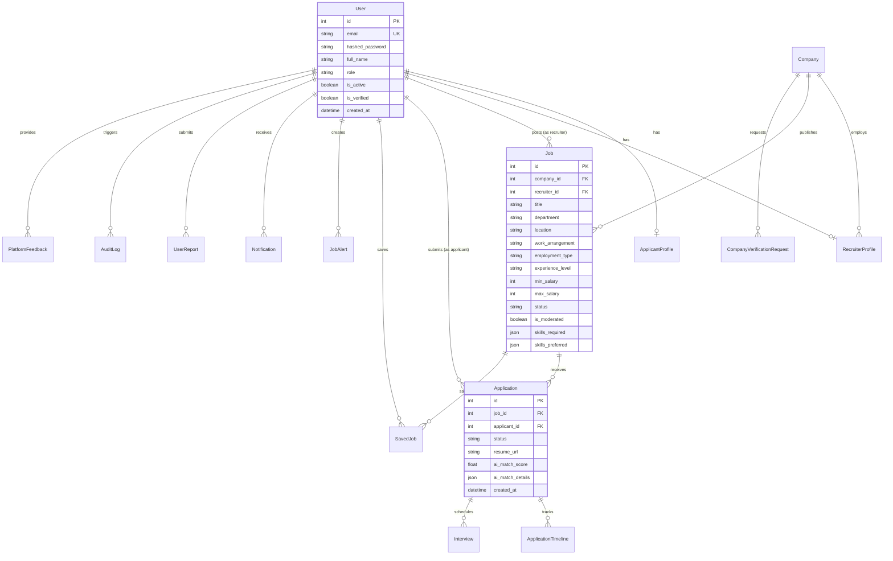

# HireNest — System Architecture Specification

## 1. Architectural Overview

HireNest is engineered as a decoupled, multi-tier Single-Page Application (SPA) and RESTful API backend architecture designed for high maintainability, strict separation of concerns, and enterprise-grade role-based platform access.

```mermaid
flowchart TD
    subgraph ClientLayer["Frontend Client (React 19 + TypeScript + Vite)"]
        UI["Tailwind Editorial Design System"]
        Router["React Router DOM v7"]
        Context["Context API (AuthContext, NotificationContext)"]
        AxiosClient["Typed Axios Client (JWT Interceptor)"]
    end

    subgraph Gateway["HTTP / REST API Layer (FastAPI)"]
        CORS["CORS Middleware"]
        StaticUploads["Static Files (/uploads)"]
        AuthRouter["/api/auth (JWT, Registration, RBAC)"]
        JobsRouter["/api/jobs (Search, Facets, CRUD)"]
        AppRouter["/api/applications (Status Pipeline)"]
        AIRouter["/api/ai (Skill Gap, Match Engine)"]
        RecruiterRouter["/api/recruiter (Analytics, Pipeline)"]
        ApplicantRouter["/api/applicant (Profile, Resumes)"]
        AdminRouter["/api/admin (Governance, Moderation)"]
    end

    subgraph ServiceLayer["Business Logic & Service Adapters"]
        AIEngine["AIService (Deterministic & AI Adapters)"]
        StorageEngine["StorageService (Sanitization, MIME Verification)"]
        AuditEngine["AuditService (Immutable Audit Logs)"]
        NotifyEngine["NotificationService (In-App Alerts)"]
    end

    subgraph PersistenceLayer["Relational Database (SQLAlchemy 2.0 ORM)"]
        SQLite[("SQLite 3 (Development)") ]
        Postgres[("PostgreSQL (Production Target)")]
        Models["15 Relational Tables with Foreign Keys & Cascades"]
    end

    UI --> Router --> Context --> AxiosClient
    AxiosClient -->|"HTTP / Bearer JWT"| CORS
    CORS --> AuthRouter & JobsRouter & AppRouter & AIRouter & RecruiterRouter & ApplicantRouter & AdminRouter
    AuthRouter & JobsRouter & AppRouter & AIRouter & RecruiterRouter & ApplicantRouter & AdminRouter --> ServiceLayer
    ServiceLayer --> Models
    Models --> SQLite
    Models -.->|"Target via DATABASE_URL"| Postgres
    StorageEngine -->|"Local Storage"| StaticUploads
```

---

## 2. Component Design & Directory Structure

```
HireNest/
├── backend/                  # FastAPI / Python Application Root
│   ├── app/
│   │   ├── core/             # Configuration, Database engine, JWT Auth & Security
│   │   ├── data/             # Realistic database seed fixtures & demo accounts
│   │   ├── models/           # SQLAlchemy 2.0 Relational Models (15 tables)
│   │   ├── routers/          # Modular REST API controllers
│   │   ├── schemas/          # Pydantic v2 validation contracts & response shapes
│   │   └── services/         # Domain services: AI matching, file storage, notifications, auditing
│   ├── tests/                # Automated pytest suite & test fixtures
│   ├── uploads/              # Isolated upload destination for applicant resumes
│   ├── pytest.ini            # Backend test configuration
│   ├── requirements.txt      # Pinned Python package dependencies
│   └── .env.example          # Environment variables template
│
├── frontend/                 # React 19 + TypeScript Single-Page Application
│   ├── public/               # Static brand assets & favicon
│   ├── src/
│   │   ├── assets/           # Visual media & imagery
│   │   ├── components/       # Editorial UI atoms: Button, Badge, Card, Modal, Sidebar, Navbar
│   │   ├── context/          # Global state: AuthContext & NotificationContext
│   │   ├── pages/            # Role-scoped workspaces (Applicant, Recruiter, Admin, Public)
│   │   ├── services/         # Typed Axios client & endpoint bindings
│   │   └── types/            # TypeScript data contracts & models
│   ├── package.json          # Frontend packages & build scripts
│   ├── tailwind.config.js    # Editorial color scheme & typography tokens
│   ├── tsconfig.json         # Strict TypeScript configuration
│   └── vite.config.ts        # Vite build toolchain
│
├── scripts/                  # Native PowerShell automation scripts for Windows
│   ├── setup-windows.ps1     # One-click environment bootstrap & dependency install
│   ├── run-backend.ps1       # Launch FastAPI backend with live reload
│   ├── run-frontend.ps1      # Launch Vite development server
│   ├── run-tests.ps1         # Run full test suite & production build validation
│   └── seed-data.ps1         # Populate database with realistic demo accounts
│
├── docs/                     # Technical documentation & architectural specs
│   ├── ARCHITECTURE.md       # Architectural blueprints & design patterns
│   ├── API_DOCUMENTATION.md  # Detailed REST API endpoint specification
│   ├── SECURITY.md           # Security model, cryptographic practices & threat mitigations
│   └── TESTING.md            # Testing strategy, pytest fixtures & QA verification
│
├── .github/
│   └── workflows/
│       └── ci.yml            # Automated CI pipeline for backend tests & frontend builds
│
├── .gitignore                # Comprehensive repository exclusions
├── .env.example              # Root environment configuration template
├── CONTRIBUTING.md           # Open-source contribution guidelines
├── LICENSE                   # Open-source MIT License
└── README.md                 # Primary portfolio repository documentation
```

---

## 3. Database Schema Design (15 Relational Entities)

The data model is implemented using SQLAlchemy 2.0 with foreign key constraints, indexes on high-frequency search fields (`email`, `job_id`, `applicant_id`), and cascaded deletes where appropriate.



---

## 4. AI Matching Engine Architecture

The AI matching system is built around a pluggable strategy pattern:

1. **Deterministic Baseline Engine (Default)**:
   - Evaluates applicant skills against required skills (weighted at 70%) and preferred skills (weighted at 30%).
   - Generates transparent, explainable match scores (0–100%) and actionable next steps.
   - Operates with zero external API dependencies, ensuring 100% test reproducibility and zero-cost local execution.
2. **Generative Model Adapters (OpenAI / Gemini)**:
   - Configurable via `AI_PROVIDER=openai` or `AI_PROVIDER=gemini` with respective API keys.
   - Provides qualitative resume summarization, deep semantic gap analysis, and tailored career development roadmaps.

