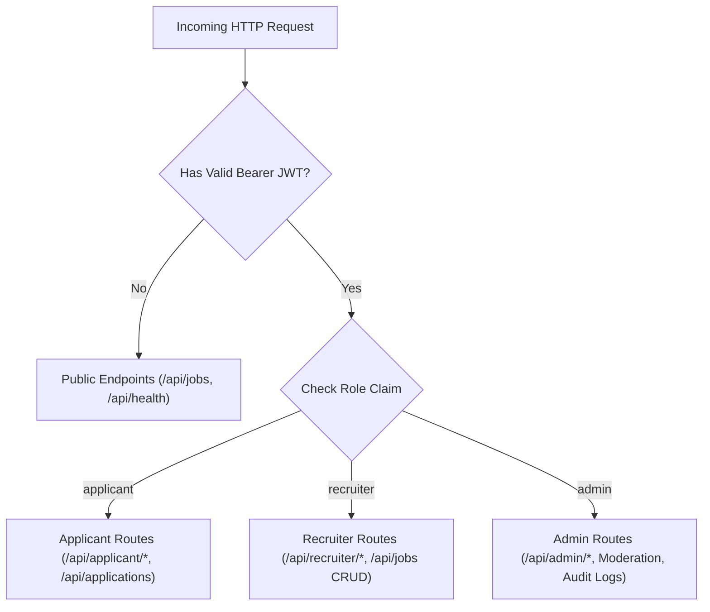

# HireNest — Security Policy & Controls

## 1. Security Overview

HireNest is engineered with defense-in-depth principles across authentication, authorization, input validation, cryptographic hashing, and file upload protection.

---

## 2. Authentication & Session Management

- **Cryptographic Password Hashing**: Passwords are never stored in plaintext. They are hashed using **PBKDF2-HMAC-SHA256** with a randomly generated 16-byte cryptographic salt and 100,000 iterations. Verification uses constant-time string comparisons (`secrets.compare_digest`) to prevent timing side-channel attacks.
- **Stateless JSON Web Tokens (JWT)**: Authentication tokens are digitally signed using the HMAC-SHA256 algorithm (`HS256`).
- **Token Claims**: Tokens encode subject user ID (`sub`), authorized role (`role`), issue timestamp (`iat`), and expiration (`exp`). Default expiration is set to 24 hours (`1440` minutes).
- **Secret Key Isolation**: Signing keys are loaded exclusively from environment variables (`SECRET_KEY`) and must never be committed to source control.

---

## 3. Role-Based Access Control (RBAC)

The application enforces strict separation of privilege across three distinct roles:

- Public registration endpoints (`/api/auth/register/applicant` and `/api/auth/register/recruiter`) strictly set roles to `applicant` and `recruiter`. Public users can **never** register with administrative privileges.
- All administrative routes (`/api/admin/*`) require the `admin` role enforced through FastAPI dependency injection (`require_roles(["admin"])`).
- Cross-role attempts (e.g. an applicant attempting to access admin metrics or delete a vacancy) are rejected with `HTTP 403 Forbidden`.

---

## 4. File Upload & Document Security

Resume file uploads (`/api/applicant/resume`) are safeguarded against arbitrary file upload attacks, path traversal, and disk exhaustion:

1. **Filename Sanitization**: Uploaded file names are stripped of path separators (`..`, `/`, `\`) and restricted via regex (`re.sub(r'[^a-zA-Z0-9_.-]', '_', filename)`).
2. **UUID Namespace Collision Defense**: Every stored file is prepended with a cryptographically unique UUID (`f"{uuid.uuid4().hex}_{clean_original}"`).
3. **Extension Whitelist**: Only approved file formats are permitted: `.pdf`, `.docx`, `.doc`, `.png`, `.jpg`, `.jpeg`. Executable scripts (`.exe`, `.sh`, `.py`, `.js`, `.bat`) are blocked with `HTTP 400 Bad Request`.
4. **File Size Enforcement**: Strict byte-length limits (default 10 MB) prevent denial-of-service through resource exhaustion.
5. **Privacy & Git Isolation**: The entire `backend/uploads/` directory is excluded from version control via `.gitignore`, preventing personal documents from leaking into public repositories.

---

## 5. Environment & Secret Hygiene

- **`.gitignore` Rules**: Root and subfolder `.gitignore` files exclude `.env`, `*.env.local`, `hirenest.db`, and `uploads/*`.
- **Safe Template Values**: `.env.example` templates contain only non-functional placeholder values.
- **Automated Random Key Generation**: The Windows setup script (`setup-windows.ps1`) automatically generates a 32-byte cryptographic secret key upon initial initialization.
- **Zero Real Credentials**: No real API keys, passwords, or production database credentials exist in tracked git files.

---

## 6. Vulnerability Reporting

If you discover a security vulnerability in HireNest, please report it privately to the maintainers rather than creating a public GitHub issue.

